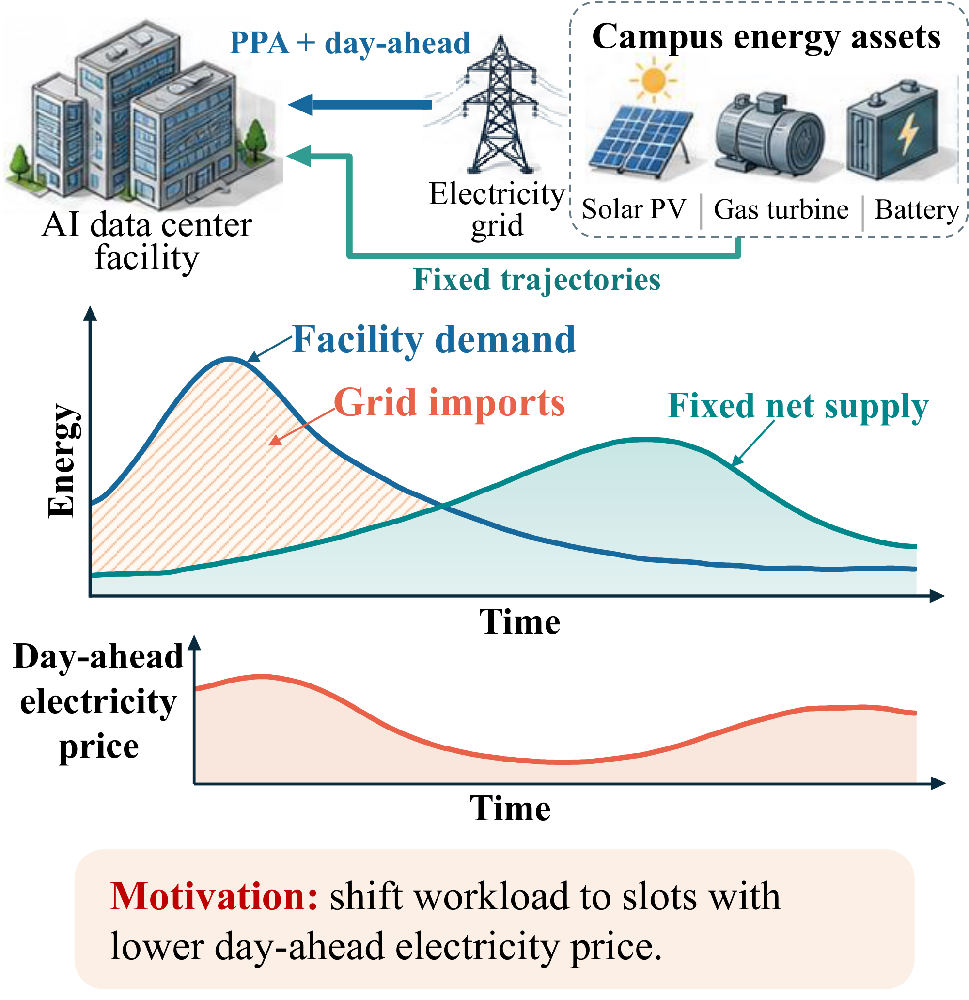
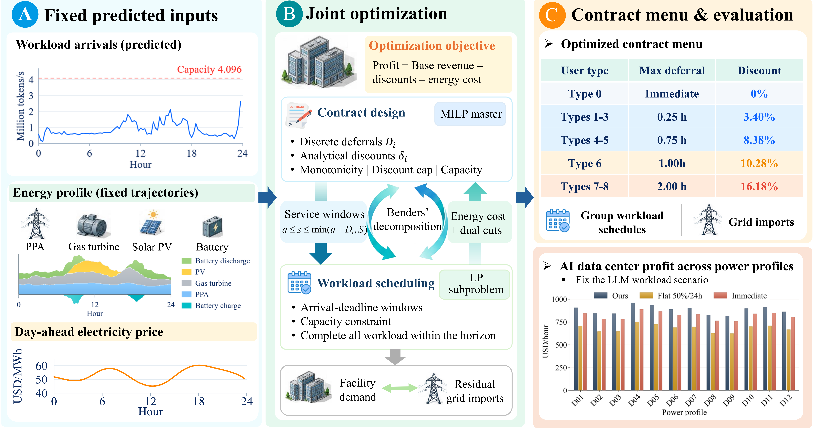

# Energy-Aware Contract Design for LLM Data Centers

This repository implements a contract-design and workload-scheduling framework for an LLM data center. Users receive token-price discounts in exchange for accepting a maximum service deferral. The operator selects the contract menu and schedules flexible workload to maximize profit under computing-capacity and energy constraints.

The framework connects heterogeneous delay preferences with electricity prices and prescribed energy-supply trajectories. It supports an LP-dual Benders algorithm, an equivalent compact mixed-integer model, and comparisons with two fixed service policies.

<details>
<summary>Motivation: shifting flexible computing to lower-cost electricity slots</summary>



</details>

## Framework



The model makes three connected decisions:

1. Select a maximum deferral for each participating user type from a discrete candidate set.
2. Derive the minimum discounts satisfying individual rationality (IR), incentive compatibility (IC), and the discount cap.
3. Allocate flexible tokens across time slots and determine grid imports, respecting arrivals, deadlines, and shared execution capacity.

Immediate-service workload executes in its arrival slot. Flexible work is aggregated exactly by arrival slot and fixed user type; sampled request copies do not need to be expanded. Only menu selections are binary. The scheduling subproblem is a continuous linear program, and the Benders algorithm uses its dual information to refine the menu master.

Profit equals undiscounted bills for served work minus discounts, fixed energy costs, and day-ahead electricity costs. PPA deliveries, gas generation, PV output, and battery charging/discharging are supplied trajectories. The optimizer schedules computing and grid imports; it does not optimize those supply or battery trajectories.

## Requirements

- Python 3.11 or newer.
- NumPy, SciPy, Matplotlib, and PyYAML, installed through `pyproject.toml`.
- Optional pandas support for data-preparation and input-visualization scripts.

Both optimization algorithms use the **HiGHS solver included with SciPy** (`scipy.optimize.milp` and `scipy.optimize.linprog`).

## Quick start

Run the following commands from this repository's root directory. They work in PowerShell and Git Bash on Windows without activating the environment:

```sh
python -m venv .venv
./.venv/Scripts/python.exe -m pip install -e .
./.venv/Scripts/python.exe -m llm_contract_optimizer validate
./.venv/Scripts/python.exe -m llm_contract_optimizer solve --algorithm benders
```

On macOS/Linux, replace `./.venv/Scripts/python.exe` with `.venv/bin/python`. Editable installation is recommended because the application uses the repository's `config/` and `data/` directories.

The remaining examples use `python` from an active environment. Optionally activate the environment with the command for your shell:

```powershell
# PowerShell
.\.venv\Scripts\Activate.ps1
```

```sh
# Git Bash
source .venv/Scripts/activate
```

You can also keep using `./.venv/Scripts/python.exe` in place of `python`, which avoids any PowerShell activation-policy restrictions.

The default configuration is [config/default.yaml](config/default.yaml): workload `R05-D333`, energy profile `D02`, a 24-hour horizon with 15-minute slots, eight participating user types, and a separate immediate-service class. These are configurable experiment settings, not measured user preferences.

The three inputs for this default case are included in Git (about 29 MiB). Additional workload scenarios and experiment inputs are distributed separately in the versioned `experiment-data-v1.zip` GitHub Release asset. Download them before using the experiment examples below:

```sh
python scripts/download_data.py
```

The configured release tag is `data-v1`; this download becomes available when the maintainer publishes that release and uploads the asset. If the release is not yet published, maintainers can install a locally built archive with `python scripts/download_data.py --archive release_assets/experiment-data-v1.zip`. See [data distribution and release instructions](docs/data_release.md) for verification and publication steps. Default validation and solving do not require the archive.

### Validate before solving

```sh
python -m llm_contract_optimizer validate
python -m llm_contract_optimizer audit-menu
```

`validate` loads the selected inputs, checks configuration and fixed labels, reports model dimensions, and runs necessary capacity screens. It does not optimize a schedule, and a passed screen alone is not a complete feasibility or optimality certificate. `audit-menu` checks the analytical contract domain without loading the workload.

### Solve a case

```sh
python -m llm_contract_optimizer solve --algorithm benders
python -m llm_contract_optimizer solve --algorithm direct
python -m llm_contract_optimizer solve --time-limit 60 --no-plot --no-group-schedule
```

Other workloads require the additional data first:

```sh
python scripts/download_data.py
python -m llm_contract_optimizer solve --workload-scenario R02-D246 --energy-scenario D02
```

After installation, `llm-contract-opt` exposes the same commands. A direct source launch is also available:

```sh
python src/llm_contract_optimizer/__main__.py validate
python src/llm_contract_optimizer/__main__.py solve
```

Launching the module or direct source file with no arguments runs the default solve and creates output files. Use `--help` to inspect available commands and command-specific options:

```sh
python -m llm_contract_optimizer --help
python -m llm_contract_optimizer solve --help
```

## Configuration

Select a configuration with `--config`, placed after the command. Experiment configurations such as this N06 example require the additional data archive:

```sh
python -m llm_contract_optimizer validate --config config/type_counts/N06.yaml
python -m llm_contract_optimizer solve --config config/type_counts/N06.yaml
```

| YAML section | Controls |
|---|---|
| `inputs` | Input directory, workload recipe, workload/energy scenario IDs, and fixed type-share checks |
| `parameters` | Horizon, slot length, computing capacity, energy coefficients, tariffs, user sensitivities, candidate deferrals, and discount cap |
| `solver` | Algorithm, time/iteration limits, numerical tolerances, token scaling, and optimality-gap targets |
| `output` | Output directory, plotting, and recovered group-schedule export |

Paths inside YAML files resolve relative to that YAML file; source paths inside workload recipes resolve relative to the recipe. User-type labels are fixed before optimization. Changing a type count, immediate-task share, or horizon requires compatible input data, rather than changing a single YAML value independently.

## Benchmarks and experiments

The `compare` command evaluates the proposed method and both benchmarks on the same inputs and installed capacity:

- **Voluntary Flat-50/24:** offer a 50% discount for a nominal 24-hour deferral. Each type accepts or rejects according to its utility; rejecting types require immediate service. Arrival-slot overflow is admitted pro rata, with excess workload dropped before flexible scheduling.
- **Immediate service with zero discount:** charge the full tariff, serve arrivals up to same-slot capacity, and drop overflow pro rata.

Dropped work earns no revenue and incurs no discount or execution-energy cost. Compare profit together with served/dropped workload, since the policies may provide different service volumes. The immediate-share experiment additionally applies an explicit pro-rata admission rule to unavoidable type-0 overflow for the proposed method; flexible work is retained for scheduling.

```sh
python -m llm_contract_optimizer compare --algorithm benders
python scripts/download_data.py
python -m llm_contract_optimizer compare --algorithm benders --profit-sweeps
```

The default `compare` uses the inputs included in Git. Profit sweeps and the experiment sweeps in the following table require `python scripts/download_data.py` first. The default `representative-day` command also works with the three inputs retained in Git. The archive contains prepared inputs, so no original raw-trace download or input regeneration is needed:

| Command | Purpose |
|---|---|
| `compare-horizons` | Compare nested consecutive windows of 12, 24, 48, 72, 96, 120, 144, and 168 hours |
| `compare-type-counts` | Compare 2, 4, 6, 8, and 10 participating types, plus immediate service |
| `compare-immediate-shares` | Compare immediate-service task shares of 10%, 20%, 30%, 40%, and 50% |
| `representative-day` | Generate arrival, scheduling, market-price, and grid-import figures for a 24-hour case |
| `compare-computational-time` | Measure Benders runtime over the horizon/type-count grid |
| `compare-contract-menus` | Compare menus across reproducibly sampled workloads and planning horizons |

Validate selected experiment inputs before running a sweep:

```sh
python -m llm_contract_optimizer compare-horizons --validate-only
python -m llm_contract_optimizer compare-type-counts --validate-only
python -m llm_contract_optimizer compare-immediate-shares --validate-only
python -m llm_contract_optimizer compare-computational-time --validate-only
python -m llm_contract_optimizer compare-contract-menus --validate-only
```

Examples of smaller or customized runs:

```sh
python -m llm_contract_optimizer compare-horizons --horizons 12 24 --no-group-schedule
python -m llm_contract_optimizer compare-type-counts --type-counts 2 6 10
python -m llm_contract_optimizer compare-immediate-shares --shares 10 30 50
python -m llm_contract_optimizer compare-computational-time --horizons 12 24 --type-counts 2 8 --repeats 3
python -m llm_contract_optimizer compare-contract-menus --seed 20261001
python -m llm_contract_optimizer representative-day
```

Use each command's `--help` for supported overrides. Full sweeps solve multiple cases and may take substantially longer than a single run. Inspect termination status and certified gaps before interpreting a time-limited solution as optimal.

## Input data and interpretation

**Workload.** The prepared workload scenarios derive from the [BurstGPT v2.0 release](https://github.com/HPMLL/BurstGPT/releases/tag/v2.0), specifically `BurstGPT_3.csv`. They retain source request token sizes and arrival timing, use sampled occurrence counts to scale workload, and store fixed type labels compactly in `.sample.json` recipes. The twelve daily scenarios were selected for sustained overload and concentrated bursts using workload characteristics and capacity screens, rather than achieved optimizer profit. They are selected stress cases, not a random sample of all operating days. Source hashes, sampling settings, and selection criteria are retained with the input data.

**Energy.** The inputs use historical day-ahead prices from [CAISO OASIS](https://www.caiso.com/systems-applications/portals-applications/open-access-same-time-information-system-oasis) and supply shapes from [CAISO Today's Outlook](https://www.caiso.com/todays-outlook/supply). Solar, wind, natural-gas, and battery shapes were scaled into research proxies for a campus PV system, PPA, turbine, and battery. They are not measurements of an actual data-center energy portfolio. Negative historical prices were floored at zero for the formulation's nonnegative-price assumption. Historical trajectories are scenario inputs, not forecasts available at contract-formation time.

**Preferences.** Delay sensitivities, task-type distributions, immediate-service shares, tariffs, and equipment parameters are modeling assumptions or calibration inputs. They should not be interpreted as empirically estimated willingness to defer.

**Scheduling.** Token groups are divisible across execution slots. The recovered schedule is a fluid allocation and does not establish that an individual autoregressive request can be split freely or rounded to a whole-request schedule without further analysis. The initial backlog is empty; all modeled work must finish within the supplied horizon. Nominal deferrals determine contract utility even when an arrival's execution deadline is clipped at the horizon end.

**Longer horizons.** Prepared windows share the same task copies and labels wherever they overlap. Workload trace days and power dates are paired by relative day and time slot; their calendar dates are not claimed to match. Nested windows are dependent cases and do not isolate the causal value of additional forecast look-ahead on a fixed evaluation timeline.

## Preparing new inputs

The default fixed-label inputs are ready to use. Download the additional data before using optional preparation or input-visualization workflows. These can rebuild type-count, immediate-share, and timing packages; use new destinations to preserve the supplied snapshots:

```sh
python scripts/download_data.py
python -m pip install -e ".[data]"
python -m llm_contract_optimizer prepare-type-counts --data-dir data/type_counts_new --config-dir config/type_counts_new
python -m llm_contract_optimizer prepare-immediate-shares --data-dir data/immediate_shares_new --config-dir config/immediate_shares_new
python -m llm_contract_optimizer prepare-computational-time --data-dir data/computational_time_new --config-dir config/computational_time_new
```

Preparation commands write input files. Fixed-label recipes include hashes and quota checks; deliberately modifying their source tables requires regenerating compatible recipes and manifests. Raw-source rebuild workflows additionally require the original BurstGPT trace and CAISO-derived power inputs; these external raw archives are not part of the data release and are not needed for the supplied experiments.

The optional root-level preparation scripts accept explicit raw-source paths:

```sh
python reselect_workload_scenarios.py --input raw_data/BurstGPT_3.csv
python prepare_planning_horizon_data.py --burstgpt-file raw_data/BurstGPT_3.csv --power-file raw_data/slot_inputs_all_days.csv
```

These commands replace prepared input packages; use a separate working copy when rebuilding data. Workload reselection preserves its baseline under `tmp/workload_reselection/`. The raw files in the examples must be supplied separately. To inspect existing inputs without rebuilding or solving, run:

```sh
python -m pip install -e ".[data]"
python scripts/download_data.py
python data_visualization/plot_scenarios.py
python data_visualization/plot_planning_horizon_inputs.py
```

Input figures are generated under the ignored `output/input_visualizations/` directory. See [input data](data/README.md) and [visualization scripts](data_visualization/README.md) for details.

## Generated outputs

Single-case runs create a timestamped directory under:

```text
results/<workload>__<energy>/<timestamp>_<algorithm>/
```

The bundle includes the contract menu in Markdown/CSV/JSON, slot schedules, an optional recovered group schedule, solver iteration history, an effective configuration, and a summary with financial accounting, numerical residuals, termination status, and certified bounds. Optional plots summarize the menu, schedule, energy balance, and convergence. Experiment commands create corresponding timestamped directories under `results/`.

Use `--no-plot` to skip supported plots, `--no-group-schedule` to reduce supported schedule exports, or `--output-dir PATH` to change the output parent. A time-limited feasible result retains its remaining certified gap. An unsuccessful run records an explicit error or infeasibility status rather than fabricating a menu.

**Generated optimization results, solver logs, caches, temporary working files, and intermediate export artifacts are intentionally excluded from this repository.** The figures under `docs/images/` illustrate the project motivation and framework; they are not numerical experiment results. Running the application creates new local outputs, which are ignored by Git.

## Repository structure

```text
contract_ai_data_center/
├── README.md
├── pyproject.toml
├── config/                    # Default and experiment configurations
├── data/                      # Default inputs and tracked data documentation/manifests
├── docs/                      # Data release guide and project illustrations
├── scripts/                   # Build, download, and verify the experiment data archive
├── release_assets/            # Locally built data release assets (ignored)
├── data_visualization/        # Scripts to inspect prepared inputs
├── prepare_*.py               # Optional source and scenario preparation tools
├── reselect_workload_scenarios.py
├── src/llm_contract_optimizer/
│   ├── cli.py                 # Commands and argument handling
│   ├── config.py              # Settings and validation
│   ├── data.py                # Input loading and exact aggregation
│   ├── menu.py                # IR/IC discount recurrence and menu checks
│   ├── inner.py               # Continuous scheduling LP and dual information
│   ├── master.py              # Benders master and compact MILP
│   ├── solve.py               # Optimization loop, bounds, and accounting
│   ├── benchmarks.py          # Fixed service-policy comparisons
│   ├── reporting.py           # Tables, plots, and result bundles
│   └── *_experiment.py        # Prepared experiment runners
└── tests/                     # Independent model and workflow checks
```

## Tests

After installing the project, run from the repository root:

```sh
python scripts/download_data.py
python -m unittest discover -s tests -v
```

The full test suite requires the additional data archive. The tests check cumulative scheduling against an independently constructed arrival-to-slot LP, validate Benders cuts, compare both algorithms with exhaustive small-menu enumeration, and exercise IR/IC constraints, input quotas, horizon boundaries, overflow policies, configuration round trips, and experiment workflows.

## License

The repository code is released under the [MIT License](LICENSE). Upstream datasets remain subject to their respective licenses and terms.
